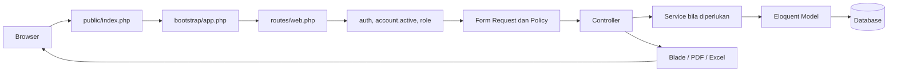

# 1. Gambaran Besar SekolahKu

SekolahKu adalah aplikasi administrasi sekolah untuk menyimpan identitas siswa dan Guru, riwayat kelas, jenis pelanggaran, catatan kejadian, rekap wali kelas, laporan sekolah, dan audit perubahan. Aplikasi menggunakan Laravel 13 pada PHP 8.3, MySQL, Blade, Tailwind CSS 4, JavaScript, dan Vite 8. Versi dependency yang diminta proyek tercatat di `composer.json` dan `package.json`; lock file mengunci versi instalasi.

## Role dan batas akses

Role login hanya dua. Wali kelas adalah penugasan pada `t_wali_kelas`, bukan role ketiga.

| Pengguna | Kemampuan yang diterapkan |
|---|---|
| Admin | Mengelola data siswa, Guru dan akun, kelas, tahun ajaran, kategori/jenis pelanggaran, penugasan wali kelas, catatan pelanggaran, laporan sekolah, serta log aktivitas. |
| Guru | Melihat direktori dan detail siswa yang diizinkan, mencatat pelanggaran siswa dari kelas mana pun, melihat riwayat pelanggaran seluruh siswa, serta melihat Catatan Saya yang hanya berisi catatan miliknya. Koreksi dan pembatalan dibatasi pada catatannya sendiri. |
| Guru wali kelas | Tetap memakai role `guru`. Selain hak Guru, ia dapat melihat dan mengekspor rekap untuk kelas/periode penugasan yang dapat diakses. Penugasan historis juga dapat dipakai saat melihat periode lama yang sah. |

Pembatasan diterapkan di route middleware, Form Request, Policy/Gate, dan query/service. Menu yang tidak ditampilkan di Blade bukan satu-satunya pengaman.

## Teknologi dan jalur request

`public/index.php` memulai Laravel melalui `bootstrap/app.php`. Route web memakai middleware web Laravel (termasuk sesi dan perlindungan CSRF untuk request yang sesuai), lalu middleware aplikasi memastikan pengguna terautentikasi, akunnya aktif, dan rolenya benar. Form Request memvalidasi input; controller mengoordinasikan request; service memusatkan alur bisnis yang lebih besar; model Eloquent mengakses tabel; Blade merender HTML.

Contoh login: `LoginRequest` memeriksa format email dan password. `AuthenticatedSessionController::store` membatasi percobaan, memeriksa kredensial serta status akun, meregenerasi sesi ketika login berhasil, lalu mengarahkan pengguna ke dashboard sesuai role. Logout mengakhiri sesi dan membuat token CSRF baru.

## Aturan data yang penting untuk dipahami

- NISN adalah identitas siswa yang unik; kenaikan kelas menambah penempatan, bukan identitas baru.
- `t_kelas_siswa` menyimpan siswa, kelas, tahun ajaran, dan periode penempatan. Catatan menunjuk ke record penempatan tersebut sehingga konteks kelas lama tidak mengikuti kelas siswa sekarang.
- Tanggal kejadian (`tanggal_pelanggaran`) berbeda dari waktu pencatatan (`tanggal_dicatat`). Saat mencatat, tanggal kejadian harus berada di dalam periode tahun ajaran dan penempatan yang dipilih.
- Poin pada master digunakan untuk catatan baru. Catatan menyimpan `poin_saat_dicatat`; mengubah master tidak mengubah catatan lama. Saat catatan dikoreksi dengan jenis baru, service mengambil snapshot poin master terbaru untuk koreksi itu.
- Total poin adalah penjumlahan snapshot pada catatan berstatus `aktif`, dan tidak memiliki batas total 100. Catatan `dibatalkan` tetap disimpan dan terlihat di riwayat, tetapi tidak dihitung sebagai poin aktif.
- Perubahan/tambah/batal catatan dan audit log ditulis dalam transaksi database agar perubahan dan log tidak terpisah.

## Peta fitur

| Area | Halaman utama | Alur kode penting |
|---|---|---|
| Autentikasi dan profil | `/login`, `/profil` | `routes/web.php` → controller auth/profil → Form Request → `t_users` dan `t_guru`. |
| Dashboard Admin | `/admin` | `AdminDashboardController` membaca siswa/Guru aktif, statistik periode, kategori, catatan, dan aktivitas terbaru. |
| Dashboard Guru | `/guru` | `GuruDashboardController` membatasi statistik dan catatan terbaru kepada Guru login; kartu rekap hanya jika ditemukan penugasan relevan. |
| Data siswa | `/admin/siswa`, `/guru/siswa` | Admin mengelola identitas dan penempatan; Guru hanya membaca. `SiswaReadService` menangani daftar, detail, riwayat, dan rekap poin. |
| Data Guru | `/admin/guru` | Identitas `t_guru` dan akun `t_users` dikelola Admin dalam relasi satu-ke-satu. |
| Data akademik | `/admin/kelas`, `/admin/tahun-ajaran`, `/admin/wali-kelas` | Pengelolaan Admin mempertahankan periode dan riwayat penempatan/penugasan. |
| Master pelanggaran | `/admin/kategori-pelanggaran`, `/admin/jenis-pelanggaran` | Admin mengelola master; jenis yang tersedia untuk pencatatan harus aktif bersama kategorinya. |
| Catat pelanggaran | `/guru/pelanggaran/create` | AJAX mencari penempatan yang cocok dengan tanggal kejadian; backend mengulang validasi dan menentukan Guru, poin, status, dan audit. |
| Riwayat dan Catatan Saya | `/guru/pelanggaran/riwayat`, `/guru/catatan-saya` | Riwayat adalah seluruh catatan yang boleh dilihat Guru; Catatan Saya tetap disaring ke pencatat yang sedang login. |
| Rekap wali kelas | `/guru/rekap-kelas` | Service memeriksa penugasan, periode, kelas, penempatan siswa, dan tanggal kejadian. Mendukung PDF dan Excel. |
| Laporan Admin | `/admin/laporan` | Filter query database, ringkasan, pagination; tersedia tampilan cetak dan PDF. |
| Log aktivitas | `/admin/log-pelanggaran` | Log catatan ditampilkan read-only melalui halaman Admin. |

Route, controller, validasi, dan file pendukung dijabarkan di [alur fitur](04-alur-fitur.md) dan [panduan membaca kode](05-panduan-membaca-kode.md).

## Batas verifikasi

Dokumentasi ini menjelaskan implementasi yang ditemukan di repository. Struktur MySQL yang benar-benar terpasang di mesin tertentu tidak otomatis sama dengan migration; database lokal tidak diperiksa di sini. Jangan menaruh isi `.env` atau data sekolah nyata ke dokumen.
