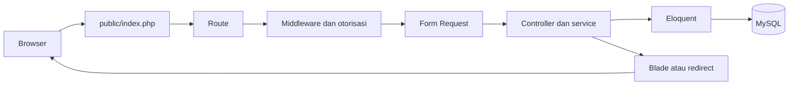

# 1. Gambaran Besar SekolahKu

SekolahKu adalah aplikasi Laravel untuk mengelola data sekolah dan mencatat pelanggaran siswa. Backend menggunakan Laravel 13 dan PHP 8.3; tampilan memakai Blade, Tailwind CSS, JavaScript, dan Vite. Data aplikasi disimpan di MySQL.

## Pengguna dan hak akses

- **Admin** mengelola data utama, akun Guru, tahun ajaran, penugasan wali kelas, laporan, dan log.
- **Guru** mencari siswa, mencatat pelanggaran, melihat riwayat, serta mengelola catatannya sesuai kebijakan.
- **Wali kelas bukan role login.** Guru mendapat rekap khusus hanya selama memiliki penugasan kelas dan periode yang sesuai.

Pengecekan akses dilakukan di backend melalui middleware, policy, dan query. Menyembunyikan menu saja tidak cukup untuk melindungi halaman.

## Aturan data utama

- NISN menjadi identitas tetap siswa.
- Penempatan siswa disimpan sebagai riwayat agar perpindahan kelas tidak mengubah konteks catatan lama.
- Catatan pelanggaran terhubung dengan penempatan pada saat kejadian.
- Poin jenis pelanggaran divalidasi pada rentang 1–100. Poin di catatan disimpan sebagai snapshot, sehingga perubahan master tidak mengubah catatan lama.
- Total poin dihitung dari catatan aktif dan tidak dibatasi maksimum 100.
- Pembatalan catatan mempertahankan record dan auditnya; catatan batal tidak ikut total poin aktif.

## Alur request

Route memilih controller. Middleware dan policy membatasi akses, Form Request memvalidasi input, lalu controller/service menjalankan alur fitur. Model Eloquent membaca atau menyimpan data; Blade menampilkan hasilnya.

## Contoh: mencatat pelanggaran

Guru memilih siswa dan jenis pelanggaran lalu mengirim tanggal kejadian. Backend memastikan penempatan siswa berlaku pada tanggal tersebut, mengambil identitas Guru dari akun login, dan membaca poin dari data master. Layanan menyimpan catatan dengan poin snapshot serta menulis log audit dalam transaksi.

## Lokasi kode

- `routes/web.php`, `routes/admin.php`, `routes/guru.php` — alamat halaman dan batas role.
- `app/Http/Requests/` — validasi dan sebagian pemeriksaan akses request.
- `app/Http/Controllers/`, `app/Services/`, `app/Policies/` — alur, aturan bisnis, dan otorisasi.
- `app/Models/` — tabel serta relasi Eloquent.
- `resources/views/` — halaman Blade.
- `database/migrations/` — struktur tabel aplikasi.
- `tests/Feature/` — pengujian alur melalui request.

## Ringkas

Route menerima request, otorisasi melindungi akses, validasi menjaga bentuk input, service menerapkan aturan bisnis, Eloquent menghubungkan data, MySQL menyimpan record, dan Blade menyajikan hasil.
