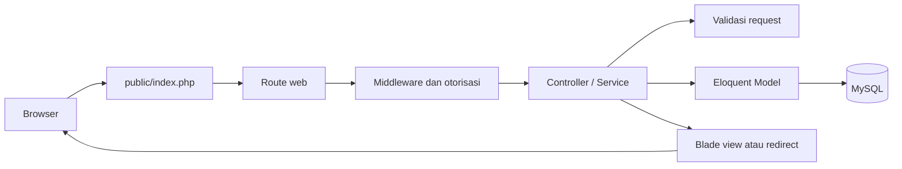

# Bab 1 — Gambaran Besar SekolahKu

## 1. Inti materi

- SekolahKu menyimpan identitas siswa dan riwayat penempatannya di kelas.
- Guru mencatat kejadian pelanggaran; poin pada catatan menjadi snapshot, sehingga perubahan nilai master tidak mengubah catatan lama.
- Akun yang diterima sistem memiliki role `admin` atau `guru`. Wali kelas adalah penugasan, bukan role login tersendiri.
- Laravel menghubungkan route, validasi, controller/service, model Eloquent, database, dan Blade.
- Tailwind CSS membentuk tampilan; Vite memproses asset frontend.

## 2. Fungsi

Aplikasi ini membantu sekolah menyimpan data siswa, guru, kelas, tahun ajaran, jenis pelanggaran, catatan kejadian, dan riwayat perubahan. Riwayat penempatan siswa membuat catatan lama tetap menunjuk ke kelas serta tahun ajaran saat kejadian berlangsung.

Implementasi memberi Admin route untuk dashboard dan pengelolaan data sekolah. Guru mendapat dashboard, pencarian siswa, pencatatan, dan akses riwayat yang dibatasi. Guru yang memiliki penugasan wali kelas dapat melihat rekap hanya untuk kelas dan tahun ajaran penugasannya. Batasan akses ditegakkan di backend melalui middleware, policy, dan query, bukan hanya dengan menyembunyikan menu.

Pada `User::isActiveAccount()`, Admin dianggap aktif; akun Guru harus terhubung dengan record Guru berstatus aktif. Penugasan wali kelas tidak menambah role login baru.

## 3. Lokasi kode

- `routes/web.php`, `routes/admin.php`, `routes/guru.php` — alamat halaman dan pengelompokan akses.
- `bootstrap/app.php` — pendaftaran alias middleware.
- `app/Http/Controllers/` — menerima request dan menentukan response.
- `app/Http/Requests/` — validasi request tertentu.
- `app/Models/` dan `app/Services/` — hubungan data dan alur domain.
- `database/migrations/` — skema tabel yang dibangun oleh Laravel.
- `resources/views/` — Blade untuk halaman dan komponen UI.
- `resources/css/app.css`, `resources/js/app.js`, `vite.config.js`, `package.json` — asset frontend dan proses build.
- `tests/Feature/` — pengujian alur HTTP/fitur.

Versi yang diminta oleh manifest Composer adalah PHP `^8.3` dan Laravel `^13.17`. `package.json` mendeklarasikan Tailwind CSS `^4.3.3`, Vite `^8.0.0`, `@tailwindcss/vite`, dan `laravel-vite-plugin`. Ini adalah rentang versi yang diminta manifest, bukan hasil pembuktian versi runtime di setiap komputer. Konfigurasi koneksi menyertakan driver MySQL.

## 4. Contoh kode aktual

File: `routes/web.php`

```php
Route::middleware(['auth', 'account.active'])->group(function (): void {
    Route::get('/profil', [ProfileController::class, 'edit'])->name('profile.edit');

    require __DIR__.'/admin.php';
    require __DIR__.'/guru.php';
});
```

File: `routes/admin.php`

```php
Route::prefix('admin')
    ->name('admin.')
    ->middleware('role:admin')
    ->group(function (): void {
        Route::get('/', AdminDashboardController::class)->name('dashboard');
        // Route Admin lain didefinisikan di dalam group yang sama.
    });
```

## 5. Penjelasan kode

- Group di `web.php` mewajibkan pengguna sudah login (`auth`) dan akunnya masih aktif (`account.active`) untuk halaman internal.
- `require` memasukkan definisi route Admin dan Guru ke group tersebut. File route terpisah membuat daftar alamat lebih mudah dibaca.
- Group Admin menambahkan prefix URL `/admin`, prefix nama route `admin.`, dan middleware `role:admin`.
- Middleware role memeriksa pengguna di server. Mengetik URL Admin secara langsung tetap melewati pemeriksaan ini.
- Potongan komentar di atas hanya penjelas; file `routes/admin.php` berisi daftar route lengkap.

## 6. Hubungan antarfile

`public/index.php` menerima request web dan memulai aplikasi melalui `bootstrap/app.php`. Laravel kemudian mencocokkan URL dengan route. Route memanggil controller; controller dapat menggunakan Form Request, policy, service, dan model. Model Eloquent membaca atau menyimpan data database. Controller mengembalikan Blade atau redirect, kemudian browser menerima HTML.

`bootstrap/app.php` mendaftarkan alias `account.active` dan `role`. Implementasi alias itu berada di `app/Http/Middleware/EnsureActiveAccount.php` dan `app/Http/Middleware/EnsureUserRole.php`. Definisi role yang diterima juga ada di `app/Models/User.php` melalui `hasSupportedRole()`.

### Diagram request sederhana



## 7. Contoh alur nyata

Saat Guru mencatat pelanggaran, browser mengirim form ke route `guru.violations.store` di `routes/guru.php`. Route berada di group role Guru. `StorePelanggaranSiswaRequest` memvalidasi penempatan, jenis pelanggaran, tanggal, dan teks. `PelanggaranSiswaController` meneruskan data yang tervalidasi ke `PencatatanPelanggaranService`. Service mengambil identitas Guru dari akun login, mengambil poin master di server, menyimpan catatan dan log dalam transaksi, lalu controller mengarahkan Guru ke detail siswa.

Frontend berarti halaman yang terlihat dan interaksi browser; backend berarti proses server seperti route, validasi, otorisasi, dan query; database berarti penyimpanan tabel dan record; server adalah proses yang menerima request; framework Laravel menyediakan pola serta komponen untuk menyusun backend aplikasi. Istilah-istilah ini berkaitan, tetapi bukan hal yang sama.

## 8. Kesalahan umum

- Mengira URL yang tidak terlihat di sidebar otomatis aman. Akses harus dicek di backend.
- Menganggap wali kelas memiliki role login ketiga. Pada model ini role login Admin/Guru; wali kelas adalah record penugasan.
- Mengira Laravel langsung menjalankan SQL setiap halaman. Query baru terjadi saat kode model/service memang meminta data.
- Menyamakan Blade dengan database. Blade hanya menyajikan data yang dikirim aplikasi.
- Menganggap semua perilaku tersimpan dalam controller. Beberapa alur penting ditempatkan di service dan Form Request.

## 9. Ringkasan hafalan

Route memilih tujuan request. Middleware dan policy membatasi siapa yang boleh menjalankan proses. Controller mengatur alur, Form Request memvalidasi input, service menjalankan aturan bisnis, dan model Eloquent berhubungan dengan tabel. Blade menampilkan hasil. MySQL menyimpan data; Vite membantu menyiapkan CSS dan JavaScript untuk browser.

## 10. Latihan

1. Dari mana pengecekan role Admin dilakukan jika pengguna mengetik URL `/admin` langsung?
2. Apa bedanya controller dan service pada alur pencatatan pelanggaran?
3. Kenapa riwayat kelas perlu disimpan terpisah dari identitas siswa?

## 11. Simulasi jawaban penguji

**Penguji:** Bagaimana alur pencatatan pelanggaran di SekolahKu?

**Contoh jawaban:** Guru mengirim form ke route Guru. Request divalidasi, lalu service mengambil data Guru serta poin dari database, menyimpan catatan dan audit dalam transaksi, kemudian aplikasi menampilkan kembali detail siswa. Guru dan poin tidak dipercaya dari input browser.
