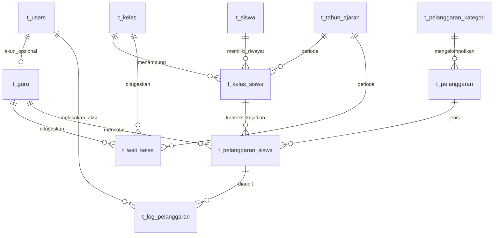

# 2. Database MySQL

Sumber skema aplikasi adalah migration di `database/migrations/`. Tabel domain memakai prefix `t_`. Laravel juga menyediakan tabel pendukung framework seperti `sessions`, `cache`, `jobs`, dan `migrations`; nama tabel pendukung tersebut bukan bagian dari 11 tabel domain SekolahKu.

> Dokumen ini menjelaskan definisi migration. Ia tidak menyatakan bahwa database MySQL lokal sudah sama. Database lokal, isi data, status migration, SQL mode, dan dump harus diperiksa terpisah sebelum operasi pemulihan atau deployment.

## Daftar tabel dan kolom

### `t_users` — akun login

Dibentuk dengan mengubah tabel `users` bawaan Laravel: `id` sebagai primary key, `name` menjadi `nama`, `email` tetap unik, `password`, dan timestamps. Migration membuang `email_verified_at` serta `remember_token`, lalu menambah `role` bertipe string(20). Password disimpan sebagai hash Laravel. Tidak ada FK yang mewajibkan Admin memiliki record Guru.

### `t_guru` — identitas Guru

| Kolom | Tipe/aturan migration | Catatan |
|---|---|---|
| `id` | big integer, PK | ID Guru. |
| `nip` | string, unique | Format NIP tidak dibatasi menjadi 18 digit oleh migration. |
| `nama` | string | Nama identitas Guru. |
| `email` | string | Aplikasi memvalidasi keunikan terhadap akun; migration tidak menaruh unique index tersendiri pada email Guru. |
| `status_aktif` | boolean, default true | Dipakai dalam pemeriksaan akun aktif. |
| `user_id` | FK ke `t_users.id`, unique, restrict delete | Menjamin satu akun untuk paling banyak satu identitas Guru; record Guru mempunyai akun terkait. |
| timestamps | timestamps | Waktu pembuatan dan pembaruan. |

### `t_siswa` — identitas siswa

| Kolom | Tipe/aturan migration | Catatan |
|---|---|---|
| `id` | big integer, PK | ID internal. |
| `nisn` | string(10), unique | Form Request juga mensyaratkan tepat 10 digit. |
| `nama` | string | Nama siswa; batas aplikasi 100 karakter. |
| `jenis_kelamin` | char(1) | Nilai aplikasi `L` atau `P`. |
| `alamat` | text, nullable | Data alamat. |
| `tahun_masuk` | unsigned small integer | Aplikasi menerima rentang 1900–2100. |
| `status_siswa` | string(20), default `aktif` | Status identitas, terpisah dari status penempatan. |
| timestamps | timestamps | Waktu pembuatan dan pembaruan. |

### `t_kelas` — data kelas

`id` PK; `nama_kelas` string(50); `tingkat` string(20); `jurusan` string nullable; timestamps. Migration tidak mendefinisikan status aktif kelas.

### `t_tahun_ajaran` — periode akademik

`id` PK; `nama_tahun_ajaran` string(20); `tanggal_mulai` dan `tanggal_selesai` date; `status_aktif` boolean default false; timestamps. Validasi aplikasi memeriksa urutan tanggal dan konflik periode.

### `t_kelas_siswa` — riwayat penempatan

`id` PK; `siswa_id` FK → `t_siswa`; `kelas_id` FK → `t_kelas`; `tahun_ajaran_id` FK → `t_tahun_ajaran`; `tanggal_mulai` date; `tanggal_selesai` date nullable; `status_aktif` boolean default true; timestamps. Semua FK memakai `restrictOnDelete()`. Index: `(siswa_id, tahun_ajaran_id)` dan `(kelas_id, tahun_ajaran_id)`. Tidak ada unique constraint database untuk mencegah benturan rentang tanggal; pemeriksaan tersebut dilakukan oleh layanan aplikasi.

### `t_wali_kelas` — riwayat penugasan wali kelas

`id` PK; `guru_id` FK → `t_guru`; `kelas_id` FK → `t_kelas`; `tahun_ajaran_id` FK → `t_tahun_ajaran`; `tanggal_mulai` date; `tanggal_selesai` date nullable; `status_aktif` boolean default true; timestamps. FK memakai `restrictOnDelete()`. Index: `(kelas_id, tahun_ajaran_id, status_aktif)` dan `(guru_id, tahun_ajaran_id)`. Konflik periode diperiksa service; tidak ada unique constraint rentang periode di migration.

### `t_pelanggaran_kategori` — kelompok master

`id` PK; `nama_kategori` string; `deskripsi` text nullable; `status_aktif` boolean default true; timestamps. Nama dibatasi 100 karakter pada validasi tambah/edit, tetapi migration tidak menambahkan unique index nama.

### `t_pelanggaran` — master jenis pelanggaran

`id` PK; `kategori_id` FK → `t_pelanggaran_kategori` dengan restrict delete; `kode` string(30), unique melalui migration tambahan; `nama_pelanggaran` string; `deskripsi` text nullable; `poin` unsigned small integer; `status_aktif` boolean default true; timestamps. Backend membatasi poin master 1–100 dan nama 100 karakter. Tipe database unsigned small integer sendiri bukan aturan bisnis rentang 1–100.

### `t_pelanggaran_siswa` — catatan kejadian

| Kolom | Tipe/aturan migration | Makna |
|---|---|---|
| `id` | big integer, PK | ID catatan. |
| `kelas_siswa_id` | FK → `t_kelas_siswa`, restrict delete | Konteks siswa, kelas, dan tahun ajaran saat kejadian. |
| `pelanggaran_id` | FK → `t_pelanggaran`, restrict delete | Jenis pelanggaran. |
| `guru_id` | FK → `t_guru`, restrict delete | Identitas Guru pencatat. |
| `tanggal_pelanggaran` | date | Tanggal kejadian. |
| `tanggal_dicatat` | datetime | Waktu pencatatan, disimpan terpisah. |
| `poin_saat_dicatat` | unsigned small integer | Snapshot poin untuk catatan ini. |
| `keterangan`, `tindakan` | text nullable | Informasi kejadian dan tindak lanjut. |
| `status` | string(20), default `aktif` | Aplikasi memakai `aktif` dan `dibatalkan`. |
| timestamps | timestamps | Waktu record dibuat/diubah. |

Index: `(kelas_siswa_id, status, tanggal_pelanggaran)` bernama `t_ps_kelas_status_tanggal_idx`; `(status, created_at)` bernama `t_ps_status_created_at_idx`.

### `t_log_pelanggaran` — audit catatan

`id` PK; `pelanggaran_siswa_id` FK → `t_pelanggaran_siswa`; `user_id` FK → `t_users`; `aksi` string(20); `data_sebelum` dan `data_sesudah` text nullable; `alasan` text nullable; `created_at` timestamp default current. FK memakai restrict delete. Index `(pelanggaran_siswa_id, created_at)` dan `(user_id, created_at)`. Tidak ada `updated_at`; halaman aplikasi menyediakan pembacaan log, bukan pengeditan log biasa. Data sebelum/sesudah diserialisasi sebagai JSON text oleh service.

## Relasi

`||--o|` di hubungan akun-Guru berarti akun boleh tidak memiliki Guru (Admin), sementara satu record Guru mempunyai satu `user_id` unik. Poin akumulasi bukan kolom saldo pada siswa; dashboard dan laporan menjumlahkan `poin_saat_dicatat` pada catatan aktif untuk periode yang dipilih. Catatan yang dibatalkan dipertahankan untuk sejarah/audit, tetapi dikecualikan dari agregat aktif.

## Urutan migration

1. `0001_01_01_000000_create_users_table.php` membangun tabel autentikasi Laravel awal.
2. `2026_10_01_121847_migrate_users_to_t_users_and_create_t_guru_table.php` mengubah `users` menjadi `t_users` dan membuat `t_guru`.
3. `2026_10_01_132222_create_sekolahku_core_tables.php` membuat tabel domain dalam urutan dependensi FK.
4. `2026_10_01_155432_add_unique_index_to_t_pelanggaran_kode.php` memastikan kode jenis pelanggaran unik dan menghentikan migration bila mendapati duplikat.

## Pemeriksaan skema aktual

Migration adalah definisi skema repository, bukan bukti keadaan server MySQL. Untuk database pengembangan yang sudah dipilih dan dikonfirmasi, `php artisan migrate:status` menunjukkan migration yang diterapkan. MySQL dapat diperiksa read-only memakai `SHOW CREATE TABLE nama_tabel` atau melalui klien Laragon. Jangan menyimpulkan database kosong atau cocok hanya dari keberadaan file migration/dump. Jangan menggunakan `migrate:fresh` atau `db:wipe` pada database yang menyimpan data.

Dump `database/ukk_pelanggaran_siswa.sql` ada di repository, tetapi dokumentasi ini tidak mengklaim kesamaan semua detail dump dengan migration atau keadaan MySQL lokal.
