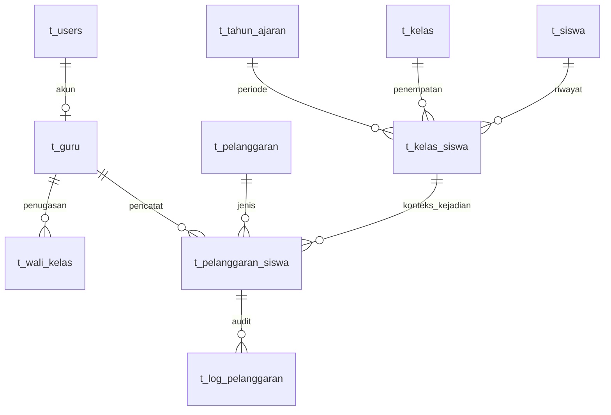

# 2. Database MySQL

Laravel membangun skema SekolahKu dari file di `database/migrations/`. Sebelas tabel domain memakai prefix `t_`; migration Laravel juga membuat tabel pendukung seperti session, cache, dan queue.

## Tabel domain

| Tabel | Fungsi |
|---|---|
| `t_users` | Akun login, role, dan password hash. |
| `t_guru` | Identitas Guru yang dapat terhubung ke akun. Admin tidak wajib memiliki identitas Guru. |
| `t_siswa` | Identitas siswa, termasuk NISN. |
| `t_kelas` | Data kelas. |
| `t_tahun_ajaran` | Periode akademik. |
| `t_kelas_siswa` | Riwayat penempatan siswa per kelas dan tahun ajaran. |
| `t_wali_kelas` | Riwayat penugasan Guru sebagai wali kelas. |
| `t_pelanggaran_kategori` | Kategori jenis pelanggaran. |
| `t_pelanggaran` | Master jenis pelanggaran dan poinnya. |
| `t_pelanggaran_siswa` | Catatan kejadian siswa, konteks penempatan, tanggal, status, dan snapshot poin. |
| `t_log_pelanggaran` | Audit aksi terhadap catatan pelanggaran. |

## Relasi penting

`t_pelanggaran_siswa.kelas_siswa_id` menunjuk ke riwayat penempatan, bukan hanya kelas siswa saat ini. Dari penempatan tersebut aplikasi mendapatkan siswa, kelas, dan tahun ajaran yang berlaku. Karena itu, perpindahan siswa tidak mengubah konteks catatan lama.

PK adalah identitas unik record. FK menghubungkan record ke tabel terkait. Unique index menolak nilai kunci yang sama; index biasa membantu query tetapi tidak menjamin keunikan.

## Poin dan riwayat

`t_pelanggaran.poin` menyimpan poin master yang berlaku untuk pencatatan baru. `t_pelanggaran_siswa.poin_saat_dicatat` menyimpan snapshot untuk satu kejadian. Laporan menjumlahkan snapshot dari catatan aktif; jumlah total siswa tidak dibatasi 100. Catatan berstatus dibatalkan tetap tersimpan, tetapi dikecualikan dari total poin aktif.

Foreign key dengan `restrictOnDelete()` membantu mencegah penghapusan record yang masih dirujuk. Penempatan dan penugasan wali kelas juga dipertahankan sebagai riwayat.

## Lokasi sumber

- `config/database.php` membaca pengaturan driver dan koneksi.
- `.env.example` adalah template konfigurasi; `.env` berisi nilai lokal dan tidak dimasukkan ke dokumentasi.
- `database/migrations/2026_10_01_121847_migrate_users_to_t_users_and_create_t_guru_table.php` menyiapkan akun dan Guru.
- `database/migrations/2026_10_01_132222_create_sekolahku_core_tables.php` membuat tabel domain utama.
- `database/migrations/2026_10_01_155432_add_unique_index_to_t_pelanggaran_kode.php` menambahkan unique index kode pelanggaran.
- `app/Models/` mendefinisikan nama tabel dan relasi Eloquent.

## Sumber kebenaran

Dump `database/ukk_pelanggaran_siswa.sql` mencantumkan sebelas tabel domain, sama dengan daftar migration. Kesamaan seluruh kolom, index, dan constraint belum dipastikan; migration tetap menjadi acuan setup aplikasi. Sebelum memakai dump untuk pemulihan atau impor, cocokkan skema dan data secara terpisah.
