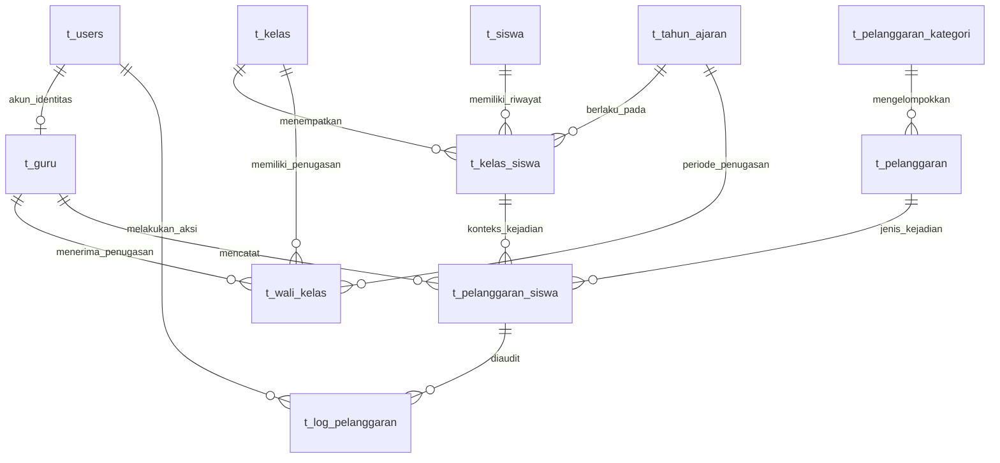

# Bab 2 — Database MySQL

## 1. Inti materi

- `.env.example` menunjukkan konfigurasi contoh untuk MySQL dengan nama `ukk_pelanggaran_siswa`; nilai lokal dibaca Laravel melalui `config/database.php`.
- Migration saat ini membuat sebelas tabel domain dengan awalan `t_`.
- `t_pelanggaran_siswa` menunjuk ke `t_kelas_siswa`, sehingga kelas dan tahun ajaran kejadian dapat diketahui dari penempatan tersebut.
- Foreign key memakai `restrictOnDelete()` untuk menjaga record sejarah yang dirujuk.
- ERD di bab ini berasal dari migration. Server MySQL lokal tidak dapat diinspeksi saat audit karena koneksinya ditolak.

## 2. Fungsi

Database menata informasi agar tidak perlu menyalin semua data ke satu tabel. Misalnya identitas siswa disimpan sekali di `t_siswa`; perubahan kelas dicatat sebagai record baru pada `t_kelas_siswa`. Catatan pelanggaran terhubung ke record penempatan tersebut, bukan hanya ke kelas siswa yang terbaru.

Istilah dasar:

- **Database**: wadah untuk kumpulan tabel.
- **Tabel**: kumpulan record dengan bentuk kolom yang sama.
- **Kolom**: satu jenis nilai, misalnya `nisn`.
- **Record/baris**: data satu siswa atau satu kejadian.
- **Primary key (PK)**: identitas unik setiap baris, biasanya `id`.
- **Foreign key (FK)**: kolom yang menunjuk PK di tabel lain.
- **Index**: struktur untuk membantu pencarian/join. Index biasa tidak menjamin nilai unik; unique index juga menolak duplikat.

## 3. Lokasi kode

- `config/database.php` — pilihan koneksi dan parameter driver.
- `.env.example` — nama variabel konfigurasi contoh tanpa rahasia lokal.
- `database/migrations/2026_10_01_121847_migrate_users_to_t_users_and_create_t_guru_table.php` — penyesuaian tabel akun dan `t_guru`.
- `database/migrations/2026_10_01_132222_create_sekolahku_core_tables.php` — sembilan tabel domain lain.
- `database/migrations/2026_10_01_155432_add_unique_index_to_t_pelanggaran_kode.php` — unique index kode pelanggaran.
- `app/Models/` — nama tabel dan relasi Eloquent.
- `database/db_ukk_2026 (1).sql` — dump SQL yang juga ada di repository, tetapi daftar tabelnya tidak sama dengan migration saat ini.

## 4. Contoh kode aktual

File: `config/database.php`

```php
'default' => env('DB_CONNECTION', 'sqlite'),

'mysql' => [
    'driver' => 'mysql',
    'host' => env('DB_HOST', '127.0.0.1'),
    'port' => env('DB_PORT', '3306'),
    'database' => env('DB_DATABASE', 'laravel'),
    'username' => env('DB_USERNAME', 'root'),
    'password' => env('DB_PASSWORD', ''),
],
```

File: `database/migrations/2026_10_01_132222_create_sekolahku_core_tables.php`

```php
Schema::create('t_kelas_siswa', function (Blueprint $table): void {
    $table->id();
    $table->foreignId('siswa_id')->constrained('t_siswa')->restrictOnDelete();
    $table->foreignId('kelas_id')->constrained('t_kelas')->restrictOnDelete();
    $table->foreignId('tahun_ajaran_id')->constrained('t_tahun_ajaran')->restrictOnDelete();
    $table->date('tanggal_mulai');
    $table->date('tanggal_selesai')->nullable();
    $table->boolean('status_aktif')->default(true);
    $table->timestamps();
    $table->index(['siswa_id', 'tahun_ajaran_id']);
});
```

File: `app/Models/KelasSiswa.php`

```php
public function siswa(): BelongsTo
{
    return $this->belongsTo(Siswa::class, 'siswa_id');
}

public function catatanPelanggaran(): HasMany
{
    return $this->hasMany(PelanggaranSiswa::class, 'kelas_siswa_id');
}
```

## 5. Penjelasan kode

- `env(...)` mengambil nilai konfigurasi dari environment; `.env` lokal tidak dimasukkan ke panduan atau repository.
- Nilai default di `config/database.php` bukan bukti nilai yang sedang dipakai. `.env` dapat memilih MySQL dan menimpa default `sqlite`.
- `foreignId(...)->constrained('...')` membuat kolom ID dan foreign key ke tabel yang disebut.
- `restrictOnDelete()` menolak penghapusan parent jika masih ada data yang merujuknya. Ini membantu menjaga riwayat, tetapi bukan pengganti validasi aplikasi.
- `nullable()` mengizinkan nilai kosong; `default(true)` mengisi status awal; `timestamps()` menambahkan `created_at` dan `updated_at`.
- `belongsTo` berarti record penempatan ini menunjuk ke satu siswa. `hasMany` berarti satu penempatan dapat memiliki banyak catatan pelanggaran.

## 6. Hubungan antarfile

Migration menjelaskan struktur untuk Laravel Schema Builder. Model menyebut nama tabel melalui `$table` dan hubungan melalui method relasi. Controller/service memakai method tersebut untuk membaca data lintas tabel. Konfigurasi koneksi menentukan server dan database yang akan dihubungi.

`.env.example` menyatakan `DB_CONNECTION=mysql` dan `DB_DATABASE=ukk_pelanggaran_siswa`. Contoh ini bukan kredensial dan tidak membuktikan service MySQL berjalan. Saat audit, koneksi ke `127.0.0.1:3306` ditolak, jadi keberadaan tabel di server aktif belum dapat dipastikan.

## 7. Contoh alur nyata dan skema

Saat sebuah catatan pelanggaran dibuat, `t_pelanggaran_siswa.kelas_siswa_id` menunjuk satu baris `t_kelas_siswa`. Baris itu menunjuk siswa, kelas, dan tahun ajaran. Kolom `poin_saat_dicatat` menyimpan snapshot nilai. Log perubahan menunjuk ke catatan dan ke pengguna yang melakukan aksi.



`||--o{` berarti satu record di sisi kiri dapat berhubungan dengan nol atau banyak record di sisi kanan. `t_users` dan `t_guru` memiliki pasangan maksimum satu-ke-satu karena `t_guru.user_id` unique; Admin tidak wajib memiliki record Guru, sehingga relasi akun-ke-identitas dapat kosong untuk Admin. Diagram menggambarkan FK yang ada di migration; aturan tanggal tumpang tindih diperiksa oleh service aplikasi dan tidak dibentuk sebagai constraint unik database.

### Ringkasan tabel domain dari migration

| Tabel | Kolom dan peran penting | Relasi, unique, dan index |
|---|---|---|
| `t_users` | `id`, `nama`, `email`, `password`, `role`, timestamps | `email` unique dari migration akun Laravel; role digunakan untuk Admin/Guru. Tidak ada FK domain keluar. |
| `t_guru` | `id`, `nip`, `nama`, `email`, `status_aktif`, `user_id`, timestamps | `nip` dan `user_id` unique; `user_id` FK ke `t_users`, restrict saat hapus. |
| `t_siswa` | `id`, `nisn`, `nama`, `jenis_kelamin`, `alamat` nullable, `tahun_masuk`, `status_siswa`, timestamps | `nisn` unique. |
| `t_kelas` | `id`, `nama_kelas`, `tingkat`, `jurusan` nullable, timestamps | Menjadi parent riwayat kelas dan penugasan wali kelas. Tidak ada unique nama kelas di migration. |
| `t_tahun_ajaran` | `id`, `nama_tahun_ajaran`, `tanggal_mulai`, `tanggal_selesai`, `status_aktif`, timestamps | Menjadi parent penempatan dan penugasan. Migration tidak membuat unique nama atau constraint periode aktif tunggal. |
| `t_kelas_siswa` | `id`, `siswa_id`, `kelas_id`, `tahun_ajaran_id`, `tanggal_mulai`, `tanggal_selesai` nullable, `status_aktif`, timestamps | Tiga FK restrict; index `(siswa_id, tahun_ajaran_id)` dan `(kelas_id, tahun_ajaran_id)`. |
| `t_wali_kelas` | `id`, `guru_id`, `kelas_id`, `tahun_ajaran_id`, tanggal mulai/selesai, `status_aktif`, timestamps | Tiga FK restrict; index `(kelas_id, tahun_ajaran_id, status_aktif)` dan `(guru_id, tahun_ajaran_id)`. |
| `t_pelanggaran_kategori` | `id`, `nama_kategori`, `deskripsi` nullable, `status_aktif`, timestamps | Parent jenis pelanggaran. |
| `t_pelanggaran` | `id`, `kategori_id`, `kode`, `nama_pelanggaran`, `deskripsi` nullable, `poin`, `status_aktif`, timestamps | `kategori_id` FK restrict; `kode` unique dibuat oleh migration berikutnya. |
| `t_pelanggaran_siswa` | `id`, `kelas_siswa_id`, `pelanggaran_id`, `guru_id`, tanggal kejadian, tanggal dicatat, `poin_saat_dicatat`, keterangan/tindakan nullable, status, timestamps | Tiga FK restrict; index `(kelas_siswa_id, status, tanggal_pelanggaran)` dan `(status, created_at)`. |
| `t_log_pelanggaran` | `id`, `pelanggaran_siswa_id`, `user_id`, `aksi`, data sebelum/sesudah nullable, alasan nullable, `created_at` | Dua FK restrict; index `(pelanggaran_siswa_id, created_at)` dan `(user_id, created_at)`. Migration tidak menambahkan `updated_at`. |

Tipe rinci di migration: `nisn` adalah string dengan panjang 10; `poin` dan `poin_saat_dicatat` adalah `unsignedSmallInteger`; `jenis_kelamin` adalah `char(1)`; alamat, deskripsi, keterangan, tindakan, dan payload audit menggunakan text; kolom tanggal dibedakan antara `date`, `dateTime`, dan `timestamp` sesuai kebutuhan.

### Tabel pendukung Laravel

Migration bawaan juga membuat tabel infrastruktur seperti `sessions`, `password_reset_tokens`, `cache`, `cache_locks`, `jobs`, `job_batches`, dan `failed_jobs`. Tabel tersebut tidak diawali `t_` karena merupakan tabel pendukung framework, bukan tabel domain SekolahKu. Jadi, sebelas tabel domain memakai prefix `t_`, tetapi tidak setiap tabel infrastruktur Laravel memakai prefix itu.

## 8. Kesalahan umum dan hal yang perlu diverifikasi

- Mengira `t_pelanggaran_siswa` menyimpan `siswa_id`, `kelas_id`, dan `tahun_ajaran_id` langsung. Migration aktual menyimpan `kelas_siswa_id`; siswa, kelas, dan tahun didapat melalui relasi penempatan.
- Menghapus siswa, kelas, atau tahun yang punya riwayat dapat ditolak oleh foreign key `restrictOnDelete()`.
- Mengira unique index sama dengan index biasa. Contoh index kombinasi kelas/tahun membantu query, tetapi tidak melarang duplikasi.
- Mengira migration sudah membuktikan kondisi server MySQL. Pada audit ini koneksi ditolak; perlu menyalakan MySQL dan menjalankan pemeriksaan baca-saja untuk membandingkan skema aktual.
- Dump `database/db_ukk_2026 (1).sql` tidak memuat `t_log_pelanggaran`, sementara migration membuatnya. Jangan menyimpulkan dump itu sama dengan skema migration atau mengimpornya tanpa pemeriksaan manual.

## 9. Ringkasan hafalan

Identitas siswa berada di `t_siswa`; riwayat kelas berada di `t_kelas_siswa`; catatan kejadian berada di `t_pelanggaran_siswa`. Catatan terhubung ke penempatan, jenis pelanggaran, dan Guru pencatat. Snapshot poin dan status menjaga perhitungan sejarah. Foreign key menjaga hubungan record, sedangkan index membantu query. Struktur yang dijelaskan berasal dari migration, bukan hasil inspeksi MySQL aktif.

## 10. Latihan

1. Bagaimana mengetahui kelas dan tahun ajaran yang terkait dengan catatan pelanggaran?
2. Apa beda foreign key dengan index biasa?
3. Kenapa `poin_saat_dicatat` perlu disimpan terpisah dari `t_pelanggaran.poin`?

## 11. Simulasi jawaban penguji

**Penguji:** Bagaimana aplikasi mempertahankan kelas saat pelanggaran terjadi?

**Contoh jawaban:** Catatan pelanggaran menyimpan `kelas_siswa_id`. ID itu menunjuk riwayat penempatan siswa yang memiliki `siswa_id`, `kelas_id`, dan `tahun_ajaran_id`, sehingga kelas kejadian tidak ikut berubah ketika siswa pindah kelas.
