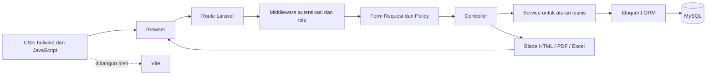

# 8. Panduan Penggunaan dan Tanya Jawab SekolahKu

> Dokumen ini menerangkan penggunaan aplikasi dan alasan rancangan sistem. Ini bukan panduan instalasi. Ringkasan menggambarkan kode sampai commit `8a23517` (8 November 2026). Akun dan isi data yang terlihat bergantung pada database lokal yang sedang dipakai.

## Gambaran cepat aplikasi

SekolahKu adalah sistem administrasi pencatatan pelanggaran siswa. Aplikasi membantu sekolah menjaga identitas siswa, kelas/tahun ajaran, penugasan wali kelas, kejadian pelanggaran, poin, rekap, dan jejak perubahan dalam satu alur.

Role login hanya **Admin** dan **Guru**. Wali kelas bukan role ketiga: Guru menjadi wali kelas karena mempunyai record penugasan untuk kelas, tahun ajaran, dan rentang tanggal tertentu.

Alur teknis satu request:

Frontend Blade mengirim request web biasa dan menerima HTML dari server; proyek ini bukan SPA. JavaScript dipakai seperlunya, misalnya untuk pencarian siswa saat mencatat pelanggaran, modal konfirmasi, serta pratinjau pemetaan kelas. Nilai penting tetap divalidasi dan ditentukan backend.

## Tools dan teknologi yang digunakan

| Bagian | Teknologi/tool | Peran dalam proyek |
|---|---|---|
| Bahasa backend | PHP 8.3 | Bahasa kode Laravel. |
| Framework backend | Laravel 13 | Routing, middleware, validasi, session, otorisasi, transaksi, dan struktur aplikasi. |
| ORM/database | Eloquent ORM dan MySQL | Relasi model dan penyimpanan data sekolah. Tabel aplikasi memakai prefix `t_`; ada 11 tabel inti dan `t_log_aktivitas` sebagai tabel audit umum. |
| Template frontend | Blade | Merender halaman server-side dan komponen antarmuka. |
| CSS | Tailwind CSS 4 | Styling monochrome, layout responsive, form, tabel, dan komponen UI. Bukan Bootstrap. |
| Interaksi browser | JavaScript | Interaksi yang diperlukan tanpa memindahkan keputusan keamanan dari server. |
| Asset bundler | Vite 8 | Memproses `resources/css/app.css` dan `resources/js/app.js` untuk browser. |
| PDF dan Excel | `barryvdh/laravel-dompdf`, `maatwebsite/excel` | Membuat laporan PDF dan spreadsheet dari cakupan data yang sudah diotorisasi. |
| Dependency PHP | Composer | Mengelola paket PHP berdasarkan `composer.json` dan `composer.lock`. |
| Dependency frontend | Node.js dan npm | Mengelola paket frontend berdasarkan `package.json` dan `package-lock.json`; menjalankan Vite. |
| Lingkungan lokal | Laragon | Menyediakan lingkungan kerja lokal PHP/MySQL yang digunakan pada komputer pengembangan. |
| CLI aplikasi | Laravel Artisan | Perintah seperti route:list, migrate:status, test, dan operasi Laravel lain. |
| QA kode | PHPUnit, Laravel Pint | Feature test untuk perilaku aplikasi; Pint untuk format kode PHP. |
| Kolaborasi source | Git dan GitHub | Riwayat commit dan sinkronisasi source code. |
| Editor/panduan AI | VS Code serta aturan proyek `.agents`/`.claude` bila dipakai | Membantu membaca dan merawat kode. Folder panduan AI bukan dependency runtime Laravel dan tidak menjalankan aplikasi. |

Versi paket yang diminta source tercatat di `composer.json`/`package.json`; versi yang terpasang terkunci di lock file. Jangan menyimpulkan versi server atau keadaan MySQL hanya dari dokumen ini.

## Ringkasan perubahan yang sudah masuk

Fitur berikut dapat ditelusuri pada kode saat ini dan riwayat repository:

1. **Fondasi aplikasi:** autentikasi Admin/Guru, session aman, pemisahan route role, profile, layout responsive monochrome, dan komponen Blade reusable.
2. **Data sekolah:** pengelolaan siswa, Guru/akun, kelas, tahun ajaran, kategori dan jenis pelanggaran, penempatan kelas, dan penugasan wali kelas.
3. **Siklus hidup siswa:** status aktif, nonaktif, pindah, keluar, dan lulus; arsip alumni tetap menyimpan riwayat. Detail siswa menyajikan penempatan serta riwayat pelanggaran.
4. **Transisi massal:** pratinjau kenaikan, tinggal kelas, pengecualian siswa, dan kelulusan kelas XII melalui detail tahun ajaran. Proses menutup penempatan asal dan mempertahankan sejarah.
5. **Data Guru:** pilihan PNS, PPPK, Non-PNS. PNS harus mengisi NIP 18 digit; PPPK/Non-PNS boleh kosong, dan NIP yang diisi tetap harus 18 digit serta unik.
6. **Pelanggaran:** pencarian siswa berdasar nama/NISN serta tanggal kejadian, pencatatan, snapshot poin, riwayat bersama, Catatan Saya, koreksi, pembatalan, dan audit.
7. **Laporan:** Dashboard Admin/Guru, Rekap Poin, Rekap Kelas wali kelas, Laporan Admin, filter, pagination, print, PDF, dan Excel.
8. **Perlindungan data:** aturan akses backend, validasi server-side, transaksi untuk perubahan yang saling terkait, pembatasan penghapusan data bersejarah, serta log aktivitas.
9. **Penyempurnaan:** pencarian dan filter dirapikan, pagination daftar, validasi poin 1-100 dan batas nama, perbaikan query agregasi rekap, serta koreksi tanggal penugasan wali kelas yang dicatat sebelum/sesudahnya.

Untuk alur teknis rinci, lihat [Alur fitur](04-alur-fitur.md), [Database MySQL](02-database-mysql.md), dan [Panduan membaca kode](05-panduan-membaca-kode.md).

### Milestone pengembangan yang tercatat di Git

| Tanggal | Milestone | Commit |
|---|---|---|
| 22 September 2026 | Rancangan awal ERD dan use case. | `cb249d6` |
| 29 September 2026 | Autentikasi dan dashboard awal. | `bea88db` |
| 1 Oktober 2026 | Fondasi database dan pengelolaan data siswa/Guru. | `90a752f` |
| 19 Oktober 2026 | Rekap wali kelas dan penyempurnaan UI. | `17332e0` |
| 21 Oktober 2026 | Validasi data dan master jenis pelanggaran. | `8830c3e` |
| 26 Oktober 2026 | Penghapusan data master yang aman. | `4edf64f` |
| 4 November 2026 | NIS/tanggal lahir siswa dan log aktivitas. | `5749be8` |
| 5 November 2026 | Status kepegawaian Guru dan kontrol riwayat penempatan siswa. | `236caec` |
| 7 November 2026 | Transisi siswa dan penyesuaian akses Guru. | `1d1decc` |
| 8 November 2026 | Koreksi tanggal penugasan wali kelas. | `8a23517` |

Tabel ini adalah ringkasan milestone dari riwayat commit, bukan daftar lengkap setiap perubahan baris kode.

## Cara menggunakan aplikasi

### Sebelum demonstrasi

Pastikan aplikasi sudah berjalan, akun yang akan dipakai aktif, dan pengguna membuka database lokal yang benar. Pada development lokal, `AuthenticationSeeder` menyiapkan `admin@sekolahku.com` untuk Admin dan `anton@sekolahku.com` untuk Guru. Password-nya ditentukan pengelola lokal melalui `SEED_ADMIN_PASSWORD` dan `SEED_GURU_PASSWORD` di `.env` lokal; password hash tidak dapat dibaca dari database. Akun ini mungkin belum ada jika seeder belum dijalankan. Jangan menggunakan data pribadi siswa sungguhan untuk demo publik.

### Alur Admin

1. **Masuk sebagai Admin.** Admin diarahkan ke Dashboard Admin yang menampilkan statistik dari database dan dapat difilter menurut tahun ajaran.
2. **Siapkan data acuan.** Kelola kelas dan tahun ajaran. Masukkan Guru beserta status kepegawaian dan akun login bila Guru perlu masuk. Pastikan akun dan identitas Guru aktif.
3. **Kelola siswa.** Buat satu identitas siswa dengan NISN unik. NIS/NISN adalah string, bukan angka hitungan, agar nol di depan tidak hilang. Tambahkan penempatan kelas untuk tahun ajaran yang benar.
4. **Jaga riwayat kelas.** Saat siswa pindah kelas, tambahkan/akhiri penempatan melalui tindakan yang tersedia. Jangan membuat identitas siswa kedua. Koreksi tanggal melalui edit penempatan; konflik tanggal dengan penempatan lain ditolak.
5. **Tangani penempatan yang salah.** Di detail siswa, gunakan penghapusan riwayat hanya bila aman. Aplikasi menolak penghapusan yang memiliki catatan pelanggaran atau akan membuat siswa aktif kehilangan penempatan pengganti. Periksa pesan blokirnya; jangan menghapus lewat SQL.
6. **Proses akhir tahun.** Buka detail tahun ajaran asal, pilih tahun tujuan dan mode Naik/Tinggal/Lulus, tampilkan pratinjau, petakan setiap kelas, kecualikan siswa yang tidak diproses, lalu konfirmasi. Proses hanya boleh dijalankan setelah tahun asal berakhir. Kelas XII harus diproses sebagai tinggal kelas atau lulus, bukan kenaikan biasa.
7. **Kelola master pelanggaran.** Buat kategori aktif lalu jenis pelanggaran dengan kode unik dan poin 1-100. Nonaktifkan master yang tidak boleh dipakai lagi; jangan menghapus master yang sudah memiliki histori.
8. **Pantau data.** Buka Laporan untuk filter seluruh sekolah, cetak atau unduh PDF. Buka Log Aktivitas untuk meninjau aktivitas administratif. Untuk perubahan catatan pelanggaran, periksa Log Pelanggaran.

### Alur Guru

1. **Masuk sebagai Guru.** Dashboard menampilkan ringkasan catatan Guru login. Menu pengelolaan master, akun, dan laporan seluruh sekolah tidak tersedia untuk Guru.
2. **Catat pelanggaran.** Isi tanggal kejadian dahulu, cari siswa dengan nama atau NISN, lalu pilih hasil yang kelas dan tahun ajarannya berlaku pada tanggal tersebut. Pilih jenis aktif, masukkan keterangan dan tindakan, kemudian simpan.
3. **Periksa poin dan kelas.** Poin, identitas Guru pencatat, dan status awal ditentukan server. Jangan menganggap nilai poin dari browser sebagai sumber kebenaran. Backend memvalidasi ulang penempatan, tahun ajaran, tanggal, serta jenis aktif.
4. **Gunakan Riwayat Pelanggaran dan Catatan Saya dengan benar.** Riwayat menampilkan catatan yang boleh dilihat Guru, termasuk catatan Guru lain. Catatan Saya hanya catatan yang dibuat akun Guru tersebut.
5. **Koreksi atau batalkan catatan.** Guru hanya boleh mengubah/membatalkan catatannya sendiri sesuai policy. Isi alasan yang diminta; record lama tidak dihapus, dan poin aktif otomatis mengecualikan catatan dibatalkan.
6. **Rekap poin.** Guru dapat melihat rekap poin yang tersedia pada menu tersendiri; ini bukan hak untuk mengelola catatan atau master.
7. **Rekap Kelas Saya.** Jika ada penugasan wali kelas yang sesuai, Guru dapat membuka rekap kelas/periode tersebut, melihat rincian dan mengekspor. Guru biasa tanpa penugasan tidak memperoleh akses ini. Wali kelas tetap dapat mencatat pelanggaran siswa dari kelas mana pun.

### Alur Wali Kelas di dalam role Guru

Rekap memakai penugasan Guru, kelas, tahun ajaran, tanggal penugasan, dan penempatan siswa. Mengubah `kelas_id`/ID tahun pada URL tidak boleh memberi akses ke kelas lain. Detail siswa dari fitur Guru hanya dibuka untuk siswa dalam kelas perwalian yang valid; menu Data Siswa Admin tidak diberikan ke Guru. Perubahan penugasan lama tidak menghapus sejarahnya.

## Kenapa sistem dirancang seperti ini?

| Keputusan | Alasan dan dampak |
|---|---|
| Role hanya Admin dan Guru | Wali kelas adalah tugas Guru yang dapat berganti per kelas/tahun ajaran. Tidak perlu akun/role ketiga yang menduplikasi identitas orang. |
| Identitas siswa dipisah dari penempatan | NISN tidak berubah saat naik kelas. Satu siswa dapat mempunyai banyak baris penempatan historis tanpa menggandakan identitas. |
| Catatan menunjuk `kelas_siswa_id` | Relasi ini menyimpan konteks kelas dan tahun ketika kejadian dicatat. Laporan tidak ikut berubah ke kelas siswa yang terbaru. |
| Poin disalin ke `poin_saat_dicatat` | Perubahan poin pada master hanya berlaku untuk catatan baru. Histori tetap memakai nilai yang berlaku ketika dicatat. |
| Total poin dihitung dari catatan aktif | Tidak ada saldo yang perlu disinkronkan manual pada record siswa. Pembatalan mengeluarkan poin dari total tanpa menghapus kejadian. |
| Dua tabel log | `t_log_pelanggaran` berfokus pada tambah/koreksi/pembatalan catatan; `t_log_aktivitas` merekam aktivitas administratif yang lebih luas. |
| Transaksi database | Perubahan record dan audit harus berhasil bersama. Jika salah satunya gagal, transaksi membatalkan perubahan parsial. |
| Soft/nonaktif atau status lebih dipilih daripada hapus histori | Riwayat dapat dibutuhkan untuk laporan, audit, dan konteks siswa/Guru; FK restrict membantu mencegah kehilangan relasi. |
| Validasi dan otorisasi di backend | HTML dapat dimanipulasi atau endpoint dapat dipanggil langsung. Middleware, Form Request, Policy, dan service menjadi pemeriksaan otoritatif. |
| Filter diterapkan pada query, ekspor terpisah dari paginator | Data yang tampil/terekspor harus sesuai akses dan filter. Ekspor laporan tidak boleh berhenti pada 10 baris halaman web. |
| Kolom angka identitas disimpan sebagai string | NIS/NISN/NIP adalah identifier, bukan bilangan untuk dijumlahkan. Format string menjaga nol awal dan panjang nilai. |

## Pertanyaan penguji yang lebih kompleks

### Apa beda `t_log_pelanggaran` dan `t_log_aktivitas`?

`t_log_pelanggaran` menyimpan audit perubahan pada satu catatan pelanggaran, termasuk pengguna, aksi, data sebelum/sesudah, alasan, dan waktu. `t_log_aktivitas` menyimpan aktivitas sistem seperti pengubahan status, penempatan, proses transisi, dan koreksi penugasan. Keduanya tidak menggantikan satu sama lain.

### Kalau poin master diedit, bagaimana memastikan total lama tetap benar?

Saat pencatatan, service membaca poin master yang aktif dan menyalinnya ke `poin_saat_dicatat`. Agregat memakai snapshot itu dan hanya status `aktif`. Jadi perubahan master berikutnya tidak mengubah kejadian terdahulu; catatan batal tetap terlihat tetapi tidak ditotal.

### Kenapa siswa lama dapat terlihat pada kelas atau tahun yang berbeda?

Siswa mempunyai satu identitas di `t_siswa` dan riwayat di `t_kelas_siswa`. Form mencari penempatan yang valid untuk tanggal kejadian, sementara laporan menggunakan penempatan yang direferensikan catatan. Penempatan masa depan tidak otomatis berarti siswa sudah berada di kelas itu hari ini; tampilan “saat ini” bergantung periode tanggal dan status yang berlaku.

### Apa yang terjadi bila seorang siswa memiliki dua penempatan yang sama-sama berlaku?

Service mencegah rentang tumpang tindih pada proses penempatan. Saat pencatatan, request/service mencocokkan siswa, kelas, tahun ajaran, dan tanggal; jika konteks valid tunggal tidak dapat ditentukan, pilihan ditolak. Jangan memilih record pertama/terakhir secara sembarang.

### Bagaimana kenaikan kelas massal mencegah pemrosesan yang salah?

Admin melihat pratinjau dari penempatan yang berlaku pada akhir tahun asal. Status siswa, tingkat kelas, penempatan ganda, penempatan tujuan yang sudah ada, konflik masa depan, dan pemetaan kelas diperiksa. Sebelum menyimpan, service memeriksa lagi kondisi penting dalam transaksi. Siswa nonaktif/pindah/keluar/lulus tidak otomatis diproses; Admin dapat mengecualikan siswa yang memenuhi syarat.

### Bagaimana proses tinggal kelas dan kelulusan berbeda?

Tinggal kelas membuat penempatan baru pada tingkat yang sama di tahun tujuan. Kenaikan memetakan ke satu tingkat di atas. Kelulusan hanya mencakup siswa kelas XII, mengubah status siswa menjadi `lulus`, dan tidak membuat penempatan tujuan. Ketiganya mempertahankan identitas dan riwayat lama.

### Mengapa catatan lama tidak diubah saat siswa naik kelas?

Catatan tetap mengacu pada penempatan historis yang dipakai ketika kejadian. Mengubah semua catatan lama ke kelas terbaru akan memalsukan konteks kejadian dan membuat laporan lama salah.

### Apakah semua Guru bisa melihat data siswa?

Guru dapat memakai pencatatan untuk memilih siswa yang mempunyai penempatan valid dan dapat melihat riwayat pelanggaran sesuai route. Detail identitas siswa bukan direktori Guru: akses detail melalui Rekap Kelas dibatasi pada wali kelas yang ditugaskan. Admin memiliki pengelolaan siswa.

### Apakah Guru dapat mencatat pelanggaran di luar kelas perwaliannya?

Ya. Penugasan wali kelas membatasi rekap khusus, bukan pencatatan umum. Saat mencatat, Guru harus memilih siswa yang penempatannya valid pada tanggal kejadian; identitas Guru pencatat tetap berasal dari akun login.

### Mengapa `NIP` memakai string 18 karakter?

Nilai NIP tidak dipakai untuk aritmetika. String menjaga nol di depan. Kebijakan form mewajibkan NIP 18 digit untuk PNS; PPPK/Non-PNS dapat tidak memiliki NIP, dan jika mengisi tetap harus 18 digit serta unik.

### Apakah feature test membuktikan aplikasi memakai MySQL?

Tidak. `phpunit.xml` menggunakan SQLite `:memory:` agar test terisolasi dan tidak mengubah database lokal. MySQL harus diuji terpisah untuk memeriksa koneksi, migration aktual, mode SQL, dan perilaku spesifik MySQL.

### Apakah angka test di dokumen hasil run sekarang?

Angka yang tercatat adalah hasil `php artisan test --compact` pada 8 November 2026: 171 test dan 1.184 assertion lulus. Perubahan dokumentasi tidak menjalankan ulang test; sebelum sidang, jalankan test pada commit terkini dan sebutkan hasil aktual.

### Mengapa fitur edit hanya mengoreksi tanggal wali kelas?

Penugasan memiliki histori kelas/Guru/tahun ajaran dan foreign key. Koreksi tanggal memang diperlukan untuk membetulkan input, tetapi mengganti pemilik/kelas/tahun melalui edit berisiko mengubah makna sejarah. Untuk pergantian orang atau konteks, buat/akhiri penugasan dengan alur yang mempertahankan record lama.

### Apa keterbatasan yang sebaiknya diakui saat sidang?

- Test automated terkini yang terdokumentasi menggunakan SQLite, bukan database MySQL produksi.
- Isi database lokal, status migration, dan kesamaan dump SQL harus diperiksa pada mesin yang dipakai untuk demo.
- Aturan bentrok tanggal utama divalidasi oleh service aplikasi; perubahan langsung di luar aplikasi dapat melewati aturan tersebut.
- Export, PDF, tampilan mobile, serta browser nyata perlu diuji secara manual pada lingkungan presentasi.
- Hasil test adalah bukti untuk kondisi commit saat dijalankan, bukan jaminan untuk konfigurasi deployment lain.

## Demo singkat yang disarankan

1. Login Admin dan tunjukkan dashboard/filter tahun ajaran.
2. Buka detail siswa untuk memperlihatkan NISN, status, riwayat kelas, serta riwayat poin.
3. Tunjukkan bahwa identitas siswa tetap sama, sementara penempatan kelas menyimpan tahun dan tanggal sendiri.
4. Login Guru, pilih tanggal kejadian, cari siswa, lalu catat satu pelanggaran menggunakan jenis aktif.
5. Tunjukkan snapshot poin, kelas pada saat kejadian, Riwayat Pelanggaran, dan Catatan Saya.
6. Koreksi atau batalkan catatan dengan alasan, lalu perlihatkan log serta dampaknya pada poin aktif.
7. Jika Guru mempunyai penugasan wali kelas, buka rekap kelas, detail siswa yang diizinkan, lalu coba jelaskan mengapa kelas lain ditolak.
8. Kembali sebagai Admin untuk laporan/cetak dan Log Aktivitas.

Jangan menjalankan proses massal kelulusan/kenaikan pada data demo penting tanpa memeriksa tahun asal, pemetaan, pratinjau, dan backup yang sesuai.
